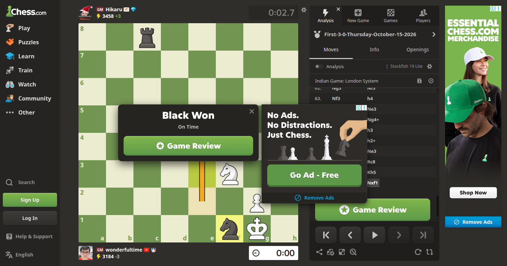
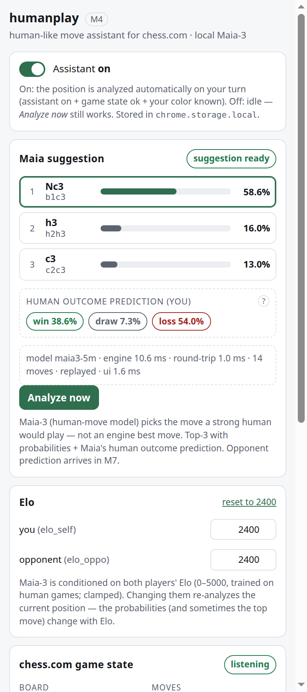
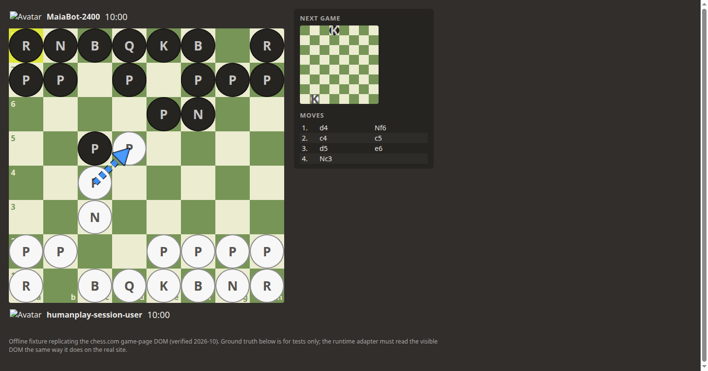
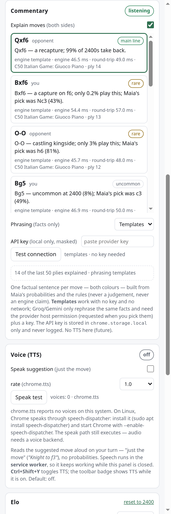

# humanplay

A Chrome extension that plays **like a strong human, not like an engine**.
It reads the live game state from a **chess.com** page, asks a **local** Maia-3
helper server for the move a ~2400-rated human would most likely play, draws it
as an arrow on the real board, speaks it out loud ("just the move"), plans one
safe premove while the opponent thinks, and explains every move it sees in one
factual sentence. No Stockfish, no cloud chess API — Maia-3 runs on your
machine.

```
chess.com tab ──DOM──► extension (MV3)  ──HTTP──►  local Maia-3 server
   adapter, overlay,    side panel, SW    127.0.0.1:8765   (separate venv,
   TTS, premove,        /analyze /premove      AGPL-3.0      CPU, ~20 MB model)
   commentary           /explain  /health
```

**Fair play:** this tool reads the game you are playing and suggests moves —
using it in live rated games can get your account banned; you accept that risk.
It ships no anti-detection features.

## Quick start

### 1. Start the local helper server (once per machine)

```bash
scripts/setup-server.sh     # uv venv + CPU torch + maia3 + model prefetch (idempotent)
scripts/run-server.sh       # serves http://127.0.0.1:8765
```

`setup-server.sh` needs [`uv`](https://docs.astral.sh/uv/) and Python 3.12
(uv can fetch it). It creates `server/.venv`, installs the CPU-only PyTorch
wheel, the pinned Maia-3 package and the server's dependencies, then
pre-fetches the Maia-3 checkpoints (5M + 79M). Running it again is a no-op.

**Model:** the server runs **Maia3-79M** by default — the most accurate model in
the family (still comfortably fast on CPU: ~0.05–0.5 s per request). Switch with
`HUMANPLAY_MODEL=maia3-5m scripts/run-server.sh` (smaller/faster).

### 2. Load the extension

1. Open `chrome://extensions`
2. Turn on **Developer mode**
3. **Load unpacked** → select the `extension/` folder of this repo
4. Pin the humanplay icon; on a chess.com game page click it to open the side
   panel (or use the puzzle-piece side-panel button)

A packaged zip is also available: `scripts/package-extension.sh` builds
`dist/humanplay-<version>.zip` (unzip it and load the unpacked folder the same
way). It verifies the zip by loading it in Chrome and checking that the service
worker registers.

## Features

| | |
|---|---|
| **Human move suggestion** | Maia-3 top-3 with probabilities + Maia's human win/draw/loss prediction, conditioned on both players' Elo (0–5000, default 2400). |
| **Arrow overlay** | The suggested move drawn on the real chess.com board (top-1 always, top-3 optional) — one click-transparent canvas, DPR-crisp, never stale. |
| **Voice (TTS)** | Speaks the suggested move — "Knight to f3", "e-pawn takes d5", "promote to queen on e8, check" — through `chrome.tts` in the service worker (works with the panel closed). Default off; `Ctrl+Shift+Y` toggles. |
| **Premove planner** | While the opponent thinks, checks whether ONE of your replies is safe to queue, draws it as a dashed blue arrow and speaks "premove …". Refuses unsafe premoves instead of guessing. |
| **Live commentary** | One factual sentence per move, both colours, built from Maia's probabilities + the rules (never a judgement). Optional Groq/Gemini *rephrasing* of the same facts with your own key. |
| **Local-only engine** | The server binds 127.0.0.1 and the extension talks only to it (plus the optional LLM providers you enable yourself). |
| **Offline-tolerant UX** | Every card shows an actionable "server offline" state with a **Copy start command** button, and recovers on its own when the server returns. |
| **Debug tools** | Kept from earlier milestones: one-frame screenshot capture and PNG fixture recording (the pixel-recognition product work is parked in `parked/`). |

## Screenshots

| | |
|---|---|
|  |  |
| Suggestion arrow on a real chess.com game | Top-3 suggestions + Maia's human win/draw/loss prediction |
|  |  |
| Safe premove (dashed blue) on the opponent's turn | Per-move commentary, both colours, with optional LLM rephrasing |

## Controls

- **Toolbar icon / puzzle-piece button** → open the side panel (that click is
  also what grants the `activeTab` permission used by the debug capture).
- **Assistant** (panel toggle) → master switch for analysis + premove.
- **Analyze now** → analyze the current position even when the assistant is off
  or it is the opponent's turn.
- **Voice (TTS)** → speak suggestions; also **Speak premoves**, rate, **Speak
  test**.
- **Ctrl+Shift+Y** → toggle TTS from anywhere (panel closed included); the
  toolbar badge shows `TTS` while on.
- **Explain moves** → the commentary feed (has its own toggle; works with the
  assistant off).
- **Copy start command** (Server card) → copies the uvicorn start command.
- **Record chess.com snapshot** → downloads a sanitized snapshot of the page's
  game DOM for the adapter's fast-fix protocol.

Full walkthrough, all settings and troubleshooting: **`docs/USER-GUIDE.md`**.

## Repository layout

```
server/     FastAPI helper + Maia-3 engine wrapper + tests  (AGPL boundary: separate venv/process)
extension/  Chrome MV3 extension (adapter, overlay, panel, service worker, TTS, vendor/chess.js)
scripts/    setup-server.sh, run-server.sh, package-extension.sh
docs/       PROJECT.md (architecture), USER-GUIDE.md, RELEASE-NOTES.md, HANDOFF.md (state log)
test/       fixtures + proofs (see "Evidence")
parked/     stopped work kept for revival (pixel recognition)
```

## Licensing / boundaries

- **Maia-3 is AGPL-3.0** (<https://github.com/CSSLab/maia3>). It is installed
  into `server/.venv` from GitHub and runs as a **separate process**; no maia3
  code is copied into `extension/`. The HTTP contract is the boundary.
- **`extension/` ships exactly one third-party runtime file**: `chess.js`
  1.4.0 (**BSD-2-Clause**, vendored in `extension/vendor/` with its LICENSE —
  see `extension/vendor/README.md`). The extension itself is this repo's code.
- **The bundled opening table** (`server/data/openings_eco.json`) is from
  lichess-org/chess-openings (**CC0-1.0**, public domain) — provenance in
  `server/data/README.md`.
- The extension declares no `<all_urls>`; its only required host permission is
  `http://127.0.0.1:8765/*`. The two LLM provider origins are **optional**
  permissions requested only when you pick a provider.

## Evidence

Every milestone ships objective proof, not claims:

- `docs/PROJECT.md` — the architecture and the frozen contracts.
- `docs/RELEASE-NOTES.md` — features mapped to the evidence (v1.0.0).
- `docs/HANDOFF.md` — the session log with exact commands and final test counts.
- `test/fixtures/captures/` — machine-readable reports + screenshots:
  `adapter/`, `analyze/`, `overlay/`, `tts/`, `premove/`, `commentary/`,
  `package/` (zip verification) and **`acceptance/`** (the M9 capstone proof:
  a full 14-ply fixture game replayed move-by-move through the real extension,
  a 104-ply soak, the rematch reset, the offline/recovery flow, plus a
  best-effort real chess.com page segment — with `acceptance/stub/` and
  `acceptance/real/` reports; see `test/fixtures/captures/acceptance/README.md`).
- `server/tests/` — pytest suites for the engine/API contracts.

Run everything yourself:

```bash
# server
cd server && .venv/bin/python -m pytest tests -q

# zero-dep unit suites (plain Node, no packages)
node test/tools/adapter-unit.mjs
node test/tools/analyze-unit.mjs
node test/tools/overlay-unit.mjs
node test/tools/tts-unit.mjs
node test/tools/premove-unit.mjs
node test/tools/commentary-unit.mjs

# browser proofs (need Chrome for Testing; see test/README.md)
CHROME="$HOME/.cache/humanplay-chrome/chrome/linux-155.0.8059.84/chrome-linux64/chrome"
node test/tools/acceptance-proof.mjs --chrome "$CHROME" --stub
```
